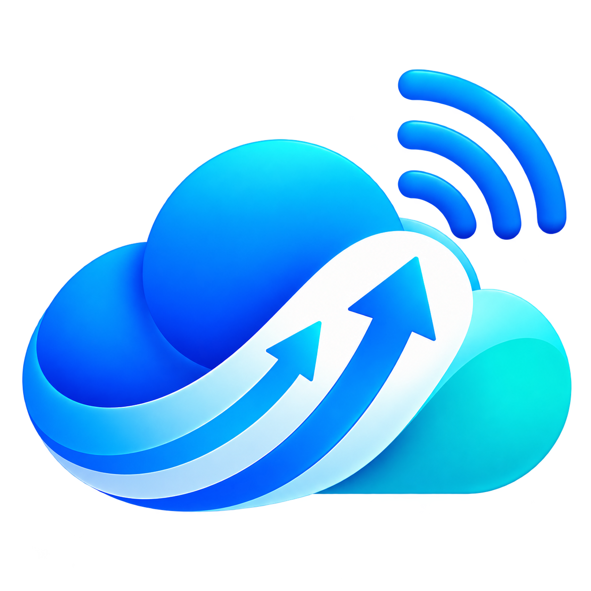

(# MyCloud 📱🚀

  

  
  
  

**MyCloud** আপনার টেলিগ্রাম অ্যাকাউন্টকে বানিয়ে তোলে একটি আনলিমিটেড, নিরাপদ ব্যক্তিগত ক্লাউড স্টোরেজ ড্রাইভ। আধুনিক মেটেরিয়াল ৩ ইন্টারফেস এবং সুপার ফাস্ট ব্যাকগ্রাউন্ড সিঙ্ক সিস্টেম।

---

## ✨ মূল বৈশিষ্ট্যসমূহ (Key Features)

* **☁️ আনলিমিটেড ক্লাউড স্টোরেজ**: টেলিগ্রাম এপিআই-এর মাধ্যমে যেকোনো সাইজের ফাইল আপলোড (২ জিবি বড় ফাইল অটো-স্প্লিট সাপোর্ট)।
* **📂 গুগল ফাইল স্টাইল ইউআই**: হোম স্ক্রিনে সুন্দর স্টোরেজ কার্ড ও রঙিন ক্যাটাগরি গ্রিড (`Apps`, `Videos`, `Images`, `Audio`, `Documents`)।
* **🔄 রিয়েল-টাইম স্মার্ট অটো ব্যাকআপ**: মোবাইল ডাটা (MB) ও Wi-Fi উভয় মাধ্যমেই ফোল্ডারের ফাইল স্বয়ংক্রিয়ভাবে সিঙ্ক হয়।
* **⚡ Strict 1-by-1 Queue**: ফোন ল্যাগ মুক্ত রাখতে ফাইলগুলো একটি একটি করে ক্রমানুসারে আপলোড হয়।
* **📥 অফলাইন-ফার্স্ট আর্কিটেকচার**: ডাউনলোড করা ফাইল অ্যাপের নিজস্ব অফলাইনে থাকে, দরকার হলে `Save to Phone` দিয়ে ফোন মেমোরিতে নেওয়া যায়।
* **🔒 ডাবল-লেয়ার সিকিউরিটি**: অ্যাপ পিন লক ও বায়োমেট্রিক আনলক (ফিঙ্গারপ্রিন্ট)।

---

## 🚀 ডাউনলোড ও ইনস্টল

সর্বশেষ রিলিজ করা APK ফাইলটি নামাতে নিচের লিংকে ক্লিক করুন:
👉 **[MyCloud Latest Release](https://xn--b5b0eua0btmi.xn--45bl4db.xn--54b7fta0cc/)**

---

Made with ❤️ by <a href="https://github.com/Yasin-Os">Yasin Adnan</a>

